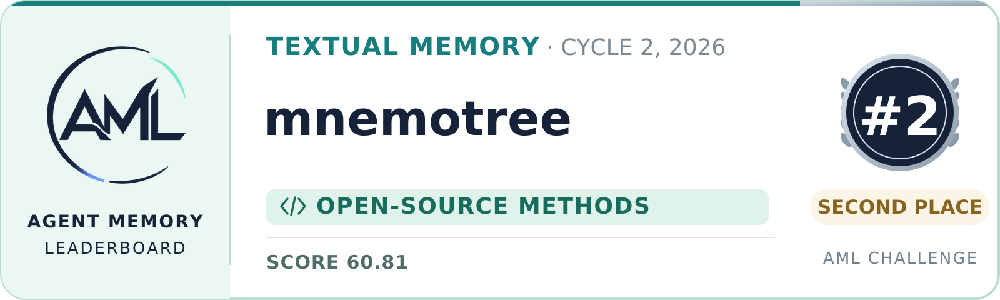

# 🌳 Mnemotree

Local, source-first memory for LLM agents: SQLite, FTS5 and sqlite-vec.

[](https://opensource.org/licenses/MIT)
[](https://www.python.org/downloads/release/python-3110/)
[](https://github.com/kurcontko/mnemotree/actions/workflows/ci.yml)
[](https://sonarcloud.io/summary/new_code?id=kurcontko_mnemotree)
[](https://github.com/kurcontko/mnemotree/actions/workflows/codeql.yml)

[](https://agentmemoryleaderboard.ai/results/cycle-2/#academic-textual)
[](#benchmarks)

<p align="center">
  
</p>

Mnemotree stores every message exactly as written and recalls the original passages
with their speaker and time. By default it runs no LLM on write or on recall, so you
get back what was said, not a model's summary of it.

- **Durable:** sources, chunks, both indexes and an idempotency receipt commit in one
  transaction.
- **Hybrid:** FTS5 BM25 and sqlite-vec cosine search, fused with RRF, with optional
  reranking.
- **Bounded:** evidence is packed into an exact token budget, with a trace of every
  candidate, rank and packing loss.
- **Isolated:** every read and write is scoped to one namespace.

The default install needs only Pydantic, sqlite-vec and tiktoken. See
[Benchmarks](#benchmarks) for the Agent Memory Leaderboard result and end-to-end
results on LoCoMo and LongMemEval.

## Try it in Claude Code

Add the published MCP server to give Claude local memory tools.

```bash
claude mcp add mnemotree -- uvx mnemotree-mcp
```

Ask Claude to remember something, start a new session, and ask about it.
The default embedding model runs locally and needs no API key.
[MCP server](#mcp-server) covers configuration and other clients.

The Claude Code plugin adds automatic capture and recall per project. Its marketplace
launcher requires `mnemotree-mcp` 1.2.0 or later on PyPI. Recalled passages become part
of the context sent to Claude. [Plugin setup and data handling](docs/GUIDE.md#claude-code-plugin)

## Install

For the Python library:

```bash
pip install mnemotree
```

Python's `sqlite3` must support loadable extensions and FTS5. Tiktoken downloads its
vocabulary once; see [the guide](docs/GUIDE.md#configuration) to run offline.

| Extra | Adds |
| --- | --- |
| `embeddings` | OpenAI-compatible HTTP embedder and extractor |
| `lite` | Local SentenceTransformer embedder |
| `serve` | HTTP service: AML Add/Search, plus routes to list, read and delete memories |
| `all` | All of the above |

## Quickstart

```python
import asyncio
from mnemotree import Memory

async def main():
    with Memory("memory.sqlite", namespace="alice") as memory:  # lexical without an embedder
        await memory.remember("I grow orchids on my balcony.", role="user")
        recall = await memory.recall("orchids")
        print(recall.context)               # packed, attributed evidence
        print([item.id for item in recall.items], recall.trace.packed_tokens)

asyncio.run(main())
```

`Memory` binds one namespace and offers `remember`, `remember_many`, `recall`, `get`
and `forget`. Pass an `embedder` for hybrid retrieval.

[examples/](examples) has three scripts to start from:

- [chat_with_memory.py](examples/chat_with_memory.py) is a chat loop that remembers
  across runs, against any OpenAI-compatible server, Ollama included.
- [multi_user.py](examples/multi_user.py) keeps one memory per user in a single
  database, with idempotent writes and deletion. It runs offline.
- [service_backend.py](examples/service_backend.py) calls the HTTP service from your
  own backend.

## Benchmarks

<a href="https://agentmemoryleaderboard.ai/results/cycle-2/#academic-textual">
  
</a>

On the [Agent Memory Leaderboard](https://agentmemoryleaderboard.ai/results/cycle-2/#academic-textual)
Cycle 2 (2026), mnemotree
placed second in Textual Memory with 60.81, 0.41 behind first.

These scores measure end-to-end question answering with the `v1.0.0` engine.
Mnemotree packs at most 8,000 tokens of evidence per question. gpt-4o-mini answers
from that evidence and also judges the answer. Embeddings come from DashScope
`text-embedding-v4` at 1,024 dimensions. Retrieval fuses BM25 and vector search
with RRF and adds the neighboring messages around each hit. No LLM runs inside
Mnemotree.

| Benchmark | Questions | Mnemotree | Published, gpt-4o-mini answering |
| --- | ---: | ---: | --- |
| LoCoMo, categories 1 to 4 | 1,540 | 72.1 | Full context (26K tokens) 72.9, Mem0 with graph 68.4, Mem0 66.9, Zep 66.0, LangMem 58.1 ([Mem0 paper](https://arxiv.org/abs/2504.19413), Table 2) |
| LongMemEval-S | 500 | 60.8 | Zep 63.8, full context (115K tokens) 55.4 ([Zep paper](https://arxiv.org/abs/2501.13956), Table 2) |

On LoCoMo-Refined, a cleaned release of LoCoMo with 1,382 questions, Mnemotree
scores 78.7 with the [official scorer](https://github.com/mem-eval-suite/LoCoMo_refined),
which judges with Qwen3-14B. That run used Nemotron-3-Embed-8B embeddings.

On [BEAM](https://arxiv.org/abs/2510.27246) we ran BEAM's own answer and scoring
code, with gpt-4.1-nano answering and gpt-4.1-mini judging. We also ran BEAM's RAG
baseline in the same harness. Its scores under the paper-era scorer match the
paper's Table 1.

| BEAM conversation length | Questions | Mnemotree | BEAM RAG, same harness |
| --- | ---: | ---: | ---: |
| 100K tokens | 400 | 37.7 | 32.5 |
| 500K tokens | 700 | 41.2 | 33.4 |
| 1M tokens | 700 | 38.5 | 31.8 |
| 10M tokens | 200 | 29.9 | 21.9 |

Mnemotree used Qwen3-Embedding-4B embeddings here. With the RAG baseline's own
bge-small embedder it still leads at every length.

Each score is a single run of ours. The published rows are the authors' own runs
with their own prompts and judges, and the Zep paper judges LongMemEval with gpt-4o.
[docs/BENCHMARKS.md](docs/BENCHMARKS.md) has the setup, the method, how to size the
evidence budget and the limitations. The evaluation harness is not in this
repository yet.

## MCP server

`mnemotree-mcp` gives Claude Code, Claude Desktop, Codex and other MCP clients the
same five tools over stdio, with semantic search on a local embedding model. It
needs no API key or configuration:

```bash
claude mcp add mnemotree -- uvx mnemotree-mcp   # Claude Code
codex mcp add mnemotree -- uvx mnemotree-mcp    # Codex
pi mcp add mnemotree -- uvx mnemotree-mcp       # Pi
```

Claude Desktop, Cursor and VS Code take the same command as a JSON entry. The guide
lists [the file each client reads](docs/GUIDE.md#client-setup), and the entry for OpenCode.

```json
{
  "mcpServers": {
    "mnemotree": {
      "command": "uvx",
      "args": ["mnemotree-mcp"]
    }
  }
}
```

The first start downloads the English-only
[granite-embedding-small-english-r2](https://huggingface.co/ibm-granite/granite-embedding-small-english-r2)
model (about 200 MB) to `~/.mnemotree/models`; the server answers while it loads.

| Setting | Flag | Default |
| --- | --- | --- |
| `MNEMOTREE_DB` | `--db` | `~/.mnemotree/memory.sqlite` |
| `MNEMOTREE_NAMESPACE` | `--namespace` | `default` |
| `MNEMOTREE_PROJECT=1` | `--project` | off: one namespace per project when on |
| `MNEMOTREE_CONFIG` | `--config` | local model |
| `MNEMOTREE_LEXICAL=1` | `--lexical` | off |

```bash
uvx mnemotree-mcp --lexical                    # keyword-only, no model download
uvx mnemotree-mcp --config ~/.mnemotree/config.json   # e.g. an HTTP embedder
```

Sessions pointed at the same database share one memory. With `pip install mnemotree`,
`mnemotree mcp` runs the same server, but with no default model: pass `--config` or
`--lexical`.

## HTTP service

The `serve` extra runs memory as a small HTTP API. Add and Search follow the
[Agent Memory Leaderboard API](https://agentmemoryleaderboard.ai/api-guide); four more
routes read and delete what is stored. Without `--config` it is lexical-only.

```bash
pip install 'mnemotree[serve]'
export MNEMOTREE_API_KEY='replace-with-your-service-key'
mnemotree-evidence --db service.sqlite serve --port 8000
```

```bash
KEY="Authorization: Bearer $MNEMOTREE_API_KEY"
curl -s localhost:8000/v1/memories/add -H "$KEY" -H 'Content-Type: application/json' -d '{
  "request_id": "r1", "user_id": "alice", "session_id": "s1",
  "messages": [{"role": "user", "content": "I moved to Warsaw last spring"}]}'
# {"success": true, ..., "ids": ["67fd494a..."]}

curl -s localhost:8000/v1/memories/search -H "$KEY" -H 'Content-Type: application/json' \
  -d '{"user_id": "alice", "query": "Where did I move?", "top_k": 5}'
# {"data": [{"id": "...", "content": "user: I moved to Warsaw last spring",
#            "score": 0.016, "source_ids": ["67fd494a..."]}]}
```

| Route (all `POST`) | Body | Returns |
| --- | --- | --- |
| `/v1/memories/add` | `request_id`, `user_id`, `session_id`, `messages` | `ids` of the stored messages |
| `/v1/memories/search` | `user_id`, `query`, `top_k` | ranked passages with their `source_ids` |
| `/v1/memories/get` | `user_id`, `ids` (up to 100) | the stored messages, and `missing` |
| `/v1/memories/list` | `user_id`, optional `session_id`, `limit`, `cursor` | a page of messages, oldest first, and `next_cursor` |
| `/v1/memories/stats` | `user_id` | counts of memories, chunks and Add requests |
| `/v1/memories/delete` | `user_id`, `id` | `deleted: true` or `false` |

Every route but `GET /health` needs the key, as `Authorization: Bearer`,
`Authorization: Token` or `X-Api-Key`. Memory IDs are unique within a user, so get
and delete always take the `user_id`. Blank messages are skipped and get no ID.

The service is built for one trusted caller: run it behind your own backend, which
authenticates your users and holds the key. `user_id` keeps users' data apart but is
not access control, and anyone with the key can read and delete every user's
memories. [The guide](docs/GUIDE.md#aml-addsearch-service) has the full contract,
the search defaults and a Docker deployment.

## Command line

```bash
# Retrieval evaluation on the bundled plumbing example (needs a fresh database).
mnemotree-evidence --db demo.sqlite --config examples/evidence/lexical.json \
  evaluate examples/evidence/corpus.jsonl examples/evidence/queries.jsonl \
  --output demo-results.json
```

`mnemotree-evidence` also runs `add`, `search`, `serve` (the HTTP service above), and
the `ablate`, `ablate-context` and `ablate-retrieval` comparisons.

## Documentation

[docs/GUIDE.md](docs/GUIDE.md) covers the API contract, MCP configuration, embeddings,
storage and retrieval behavior, atomic projections, the AML service, evaluation
and limits. [docs/BENCHMARKS.md](docs/BENCHMARKS.md) records how the benchmark
numbers were produced and what they leave out.

Releases up to 0.4.0 shipped `MemoryCore`, pluggable vector/graph backends and an
older MCP server. They have been removed, and `Memory` does not read their databases.
See [upgrading from 0.4.0](docs/RELEASE_NOTES.md#upgrading-from-040-or-earlier) in the
release notes for API and compatibility changes.

## Development

```bash
git clone https://github.com/kurcontko/mnemotree.git
cd mnemotree
uv sync --extra dev --extra serve
make lint typecheck test
make build
make precommit-install
```

See [CONTRIBUTING.md](CONTRIBUTING.md).

## License

MIT, see [LICENSE](LICENSE).
